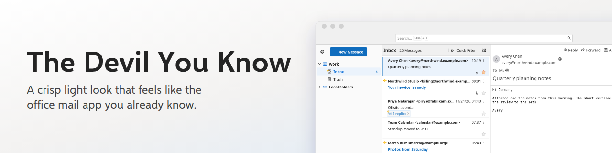
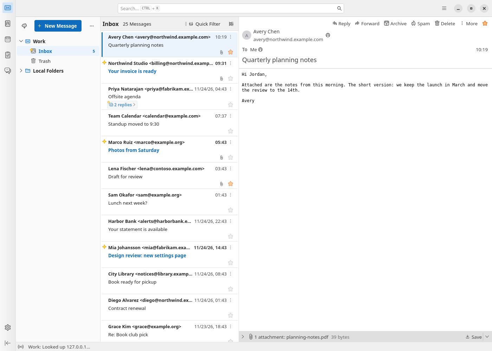
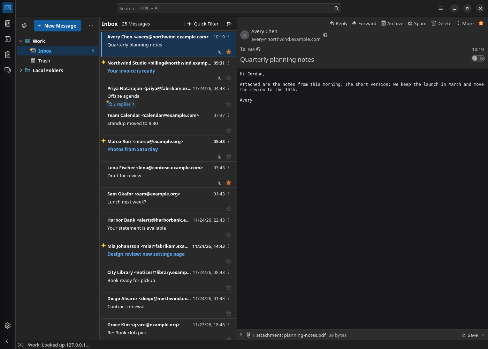
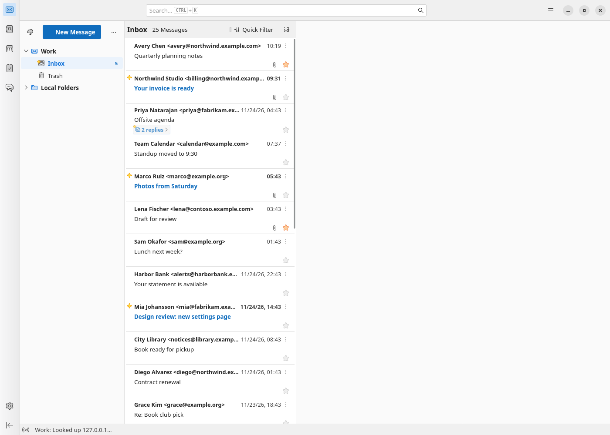
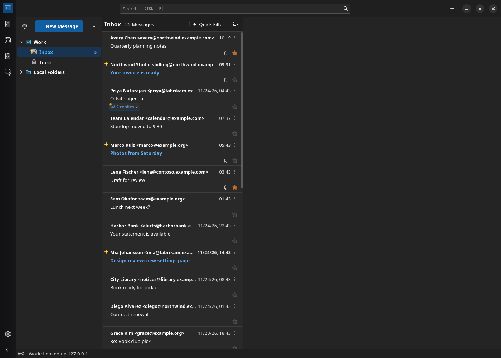
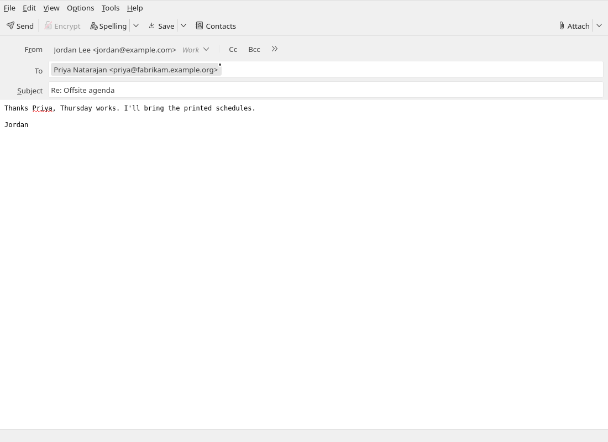
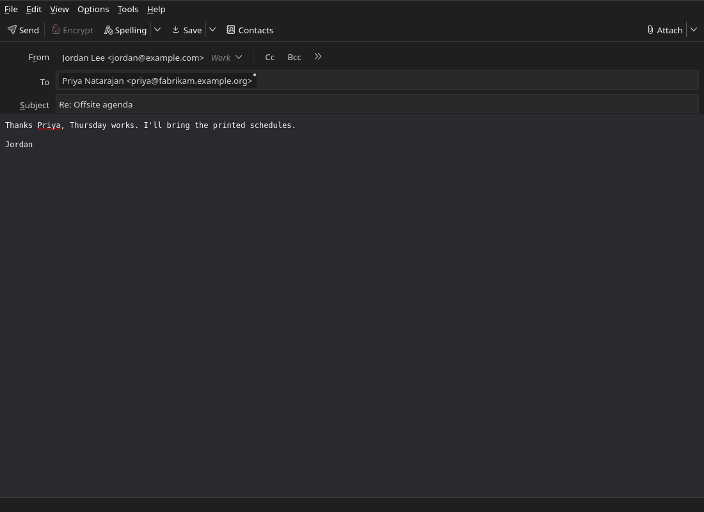
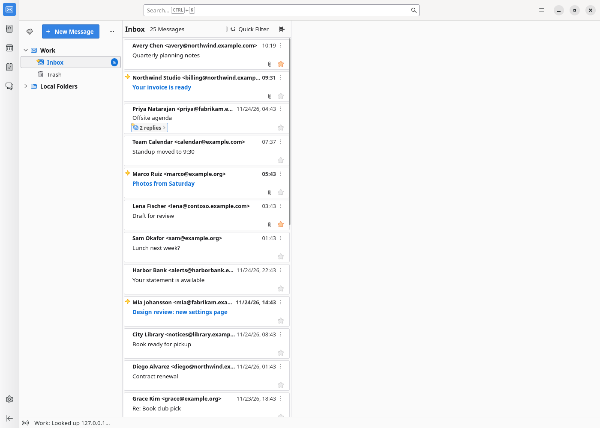

# The Devil You Know

A crisp light look that feels like the office mail app you already know.

A theme for Thunderbird 140 and newer, and Betterbird. Light and dark.

  
  

## What it changes

- White panes with thin dividers instead of floating cards.
- One blue accent: links, unread subjects, the New Message button, and a blue edge on the selected message.
- A pale blue selected folder.
- Flat header buttons.
- A matching dark mode that follows the system setting.
- Built on Thunderbird's own style variables. Anything the theme does not cover keeps Thunderbird's default look.

Tip: View > Layout > Vertical View gives the familiar three-column layout.

## Install

- From addons.thunderbird.net (coming soon).
- Or download `the-devil-you-know-0.1.0.xpi` from the GitHub Releases page. Then open Thunderbird > Add-ons and Themes, click the gear, and choose Install Add-on From File.

The self-hosted build updates itself from `updates.json`.

## Compatibility

| App | Tested version | Result |
|---|---|---|
| Thunderbird 140 ESR | 140.17.0esr | Works, light and dark |
| Thunderbird, current release | 159.0 | Works, light and dark |
| Betterbird | 153.8.0esr | Works, light and dark |

On Thunderbird 140, a few toolbar and menu colors come from the manifest instead of the stylesheet. The look is the same.

## More screenshots

Inbox, light and dark:

  
  

Compose window, light and dark:

  
  

Thunderbird's default look, for comparison:

## How it's built

- `theme/manifest.json` holds the colors for light and dark, and points to a `theme_experiment` stylesheet.
- `theme/theme.css` has three parts: 1. design values, 2. Thunderbird variables pointed at those values, 3. a few targeted rules.

More detail is in the [wiki](https://github.com/JR91387/the-devil-you-know-thunderbird-theme/wiki).

## Build and test

- `npm run build` writes `dist/the-devil-you-know-0.1.0.xpi` and `dist/the-devil-you-know-0.1.0-atn.xpi`.
- `npm test` runs 9 checks: manifest, author header, package contents, ATN rules, and text contrast of at least 4.5:1.
- `npm run lint` runs stylelint on the CSS.

Needs Node and Python 3. Nothing else.

## About the author

**Jerry Reinitz** works at the intersection of healthcare data, clinical operations
and technology: healthcare intelligence, LLM and AI orchestration, and software
engineering, with 12 years at the seam between clinical operations and the systems
that run them. He builds tools that reduce friction, surface better information,
and give people more time for the work that matters.

- Website: https://jerryreinitz.com
- Reinitz Industries: https://reinitzindustries.com
- GitHub: https://github.com/JR91387
- LinkedIn: https://www.linkedin.com/in/jerryreinitz/

More in [AUTHOR.md](AUTHOR.md).

## License

MIT. See [LICENSE](LICENSE).

Fonts in `assets/fonts` are under the SIL Open Font License. See the OFL files there.
